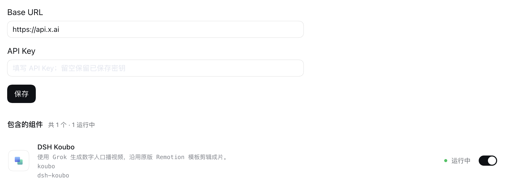
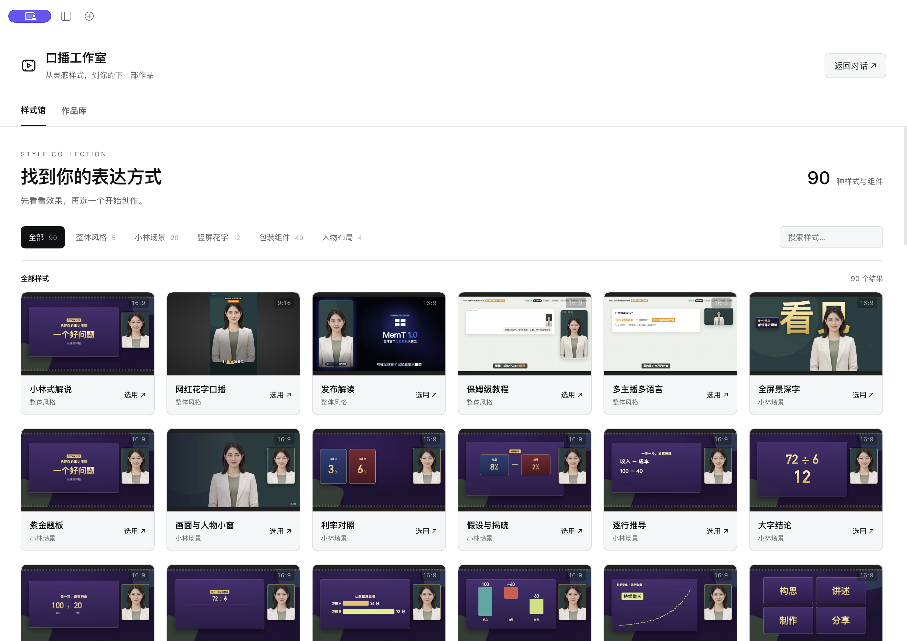
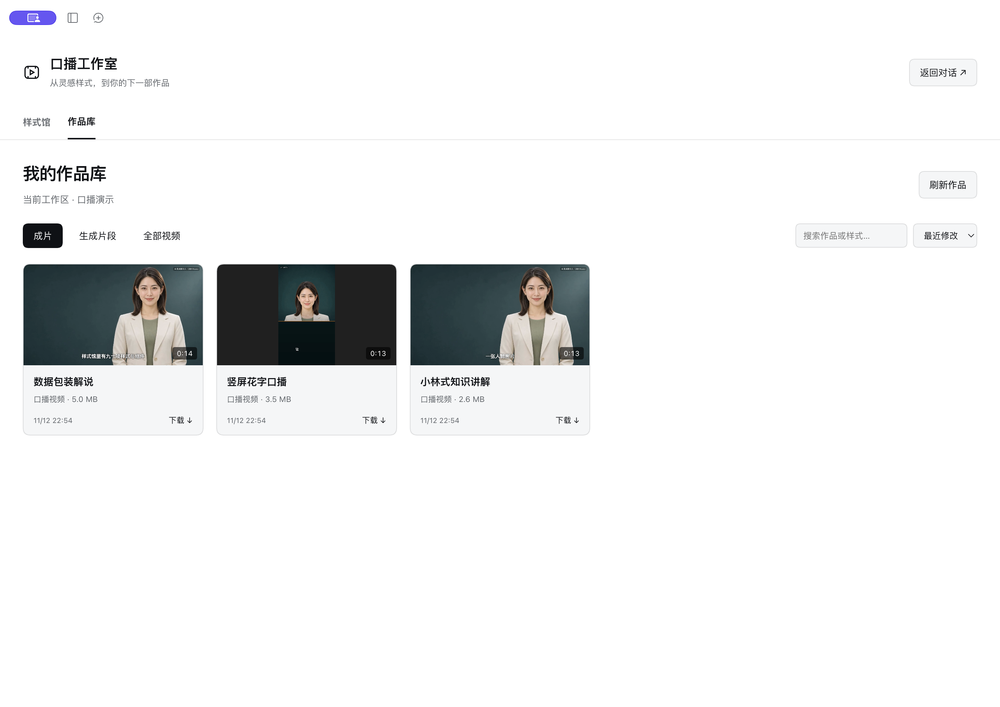
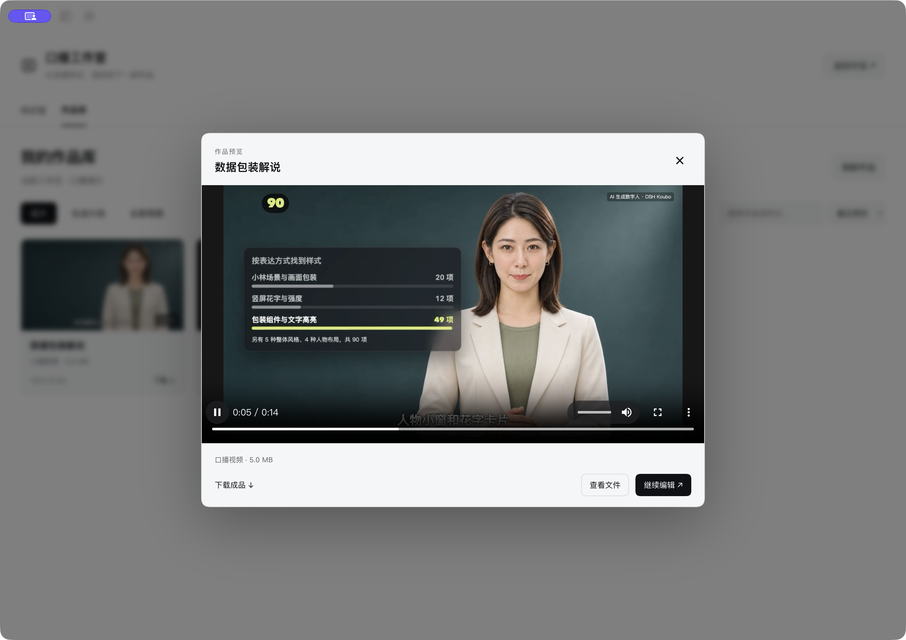

<p align="center">
  <strong>给一张人物图、一段讲稿，让 DSH 帮你做口播视频。</strong><br>
  DeepSeek Harness 的数字人口播插件 · 样式预览 · 成片管理
</p>

<p align="center">
  <a href="https://github.com/xhznAI/dsh-koubo"></a>
  <a href="https://github.com/xhznAI/dsh-koubo/stargazers"></a>
  <a href="LICENSE"></a>
  <a href="docs/setup.md#支持的环境"></a>
</p>

<p align="center">
  <a href="#安装">安装</a> ·
  <a href="#开始使用">开始使用</a> ·
  <a href="#成片效果">成片效果</a> ·
  <a href="docs/setup.md">配置手册</a> ·
  <a href="docs/development.md">开发文档</a>
</p>

## 安装

打开 DSH 侧栏 **插件 → 添加插件 → 安装第三方插件**，在「包名或地址」中填入：

```text
github:xhznAI/dsh-koubo#main
```

安装后启用 **DSH Koubo**，侧栏就会出现「口播工作室」。此来源安装主分支的当前版本，无需手动下载或编译。支持的 DSH 版本及其他安装方式见[配置手册](docs/setup.md#安装)。

## 开始使用

### 1. 配置视频服务

打开 **插件 → DSH Koubo**，滚到详情页下方，填写视频服务的 **Base URL** 和 **API Key**，点击「保存」。



*图中为填写示例，请使用你自己的服务信息并保存。*

Base URL 使用服务商提供的 Grok 视频 API 地址，默认是 `https://api.x.ai`；API Key 填同一家服务商的密钥。当前使用 `grok-imagine-video-1.5`，渠道需要支持该模型。[查看完整配置说明](docs/setup.md#配置视频服务)

### 2. 选一个样式

进入 **口播工作室 → 样式馆**，预览小林式讲解、竖屏花字、人物小窗和图表包装等 **90 项样式与组件**。点「选用」后，样式要求会填入对话草稿。



### 3. 给它讲稿和人物图

把素材放进当前工作区，在对话中说明你想做什么：

> 用口播技能，把这段讲稿做成小林式横屏视频，人物图用 presenter.png。先做一个口播片段给我看，确认后再剪成完整视频。

助手会准备工程、生成口播、对齐字幕并完成剪辑。制作时按所选模板检查本地工具；依赖说明见[配置手册](docs/setup.md#本地剪辑工具)。

## 成片效果

同一位原创 AI 数字人，用三种风格介绍插件。点击下方链接查看带声音的成片。

| 小林式知识讲解 · 16:9 | 竖屏花字口播 · 9:16 | 数据包装解说 · 16:9 |
| --- | --- | --- |
| <a href="assets/readme-cases/lin-explainer.mp4"></a> | <a href="assets/readme-cases/huazi-short.mp4"></a> | <a href="assets/readme-cases/data-packaging.mp4"></a> |
| 人物讲解、题板与圆形小窗 | 关键词花字、清单与对比卡片 | 数字强调、数据面板与步骤说明 |
| [▶ 播放有声视频](assets/readme-cases/lin-explainer.mp4) | [▶ 播放有声视频](assets/readme-cases/huazi-short.mp4) | [▶ 播放有声视频](assets/readme-cases/data-packaging.mp4) |

人物和口播由 AI 生成，画面使用随插件提供的原版模板与组件。[讲稿与分镜](examples/readme-cases) · [复现案例](docs/development.md#复现-readme-案例)

## 作品集中放，随时接着改

在 **作品库** 搜索、播放和下载当前工作区的视频，也可以点「继续编辑」回到对话。横屏、竖屏共用一套预览窗口，完整保留画面比例。



成片保存在 `video/koubo` 或其中模板工程的 `out` 文件夹，点击「刷新作品」即可查看。

<details>
<summary>查看样式动效和成片播放界面</summary>




</details>

*界面截图均来自实际运行的 macOS 版 DSH，作品库展示的是上方三条案例。*

---

## Acknowledgements

- [digital-human-koubo](https://github.com/andyhuo520/digital-human-koubo)：原版数字人口播工作流、Remotion 模板与包装组件，保留其布局和动效。
- [DeepSeek Harness](https://github.com/deepseek-ai/deepseek-harness)：提供插件系统与创作对话。
- [Remotion](https://www.remotion.dev/) 与 [FFmpeg](https://ffmpeg.org/)：提供视频编排、渲染与音视频处理能力。

[原版来源与版本](skills/koubo/upstream.json) · [第三方许可](THIRD_PARTY_NOTICES.md) · [配置手册](docs/setup.md) · [开发与宿主接入](docs/development.md)

Made by [zhoufeiyu · xhznAI](https://github.com/xhznAI) · [MIT License](LICENSE)
