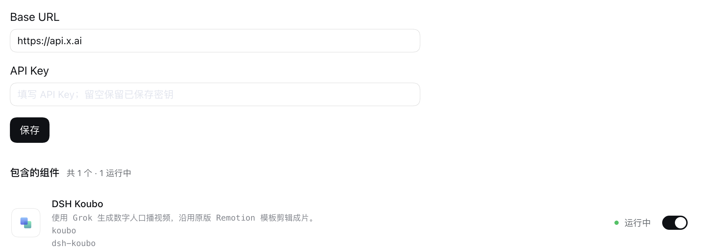

# DSH Koubo 配置手册

[← 回到首页](../README.md)

## 安装

1. 打开 DSH 侧栏 **插件 → 添加插件 → 安装第三方插件**。
2. 在「包名或地址」中填入 `github:xhznAI/dsh-koubo#main`，完成安装。
3. 启用 **DSH Koubo**，在详情页下方填写视频服务信息。

GitHub 来源安装主分支的当前版本，仓库已包含编译文件，无需本地构建。更新时在插件管理中更新；如当前 DSH 没有更新入口，可卸载后重新使用同一来源安装。已安装旧包 `@nex-assistant/koubo` 时，先停用旧包，避免同时启用两份插件。

也可从 [GitHub Releases](https://github.com/xhznAI/dsh-koubo/releases) 下载某个已发布版本的 `.tgz`，把本地安装包路径填入同一个输入框。Release 附件对应各自的版本，可能与主分支不同。

## 支持的环境

- DSH：`0.2.1-rc.5`、`0.2.2-rc.1`、`0.2.2-rc.2`。
- Node.js：24 或更高版本；使用 DSH Desktop 时由桌面应用管理运行环境。
- 界面运行于 DSH Web / Desktop；README 实机截图来自 macOS Desktop。

## 配置视频服务

打开 **插件 → DSH Koubo**，滚到详情页下方的 Base URL / API Key 表单。

*图中使用默认地址演示，实际地址以服务商提供的信息为准。*

| 配置项 | 填什么 |
| --- | --- |
| **Base URL** | 服务商提供的 Grok 视频 API 地址，默认 `https://api.x.ai`；也可填写兼容渠道的地址 |
| **API Key** | 上述服务商的有效视频服务密钥 |

填写后点击 **保存**。当前默认模型为 **Grok Imagine Video 1.5**（`grok-imagine-video-1.5`），不需要另外填写模型名；使用自定义渠道前，确认它支持该模型及 Grok 视频生成接口。

- 地址可以是域名根路径，也可以以 `/v1` 结尾。
- API Key 留空保存会保留已有密钥；保存后输入框清空是正常行为。
- 密钥在插件设置中填写，不要放进讲稿、对话或工程文件。
- 「已保存」表示设置写入成功，不代表渠道连通或生成成功。可以先让助手生成一个短片段检查效果；生成会使用所填服务的额度。

## 本地剪辑工具

浏览样式馆和已有作品不需要视频服务密钥。生成新口播需要配置视频服务；剪辑和渲染还会按模板使用下列工具：

| 工具 | 用途 |
| --- | --- |
| FFmpeg / FFprobe | 视频剪切、音频处理与成片检查 |
| Python / uv | 运行随技能提供的剪辑脚本并管理 Python 依赖 |
| whisper.cpp | 回听转写与字幕对齐 |
| Node.js / Remotion | 模板预览和成片渲染，依赖安装在对应工程中 |

可以先在对话中说：「用口播技能检查当前工作区的制作环境，列出缺少的工具。」

## 样式与作品

样式馆提供 90 项预览，包括整体风格、小林场景、人物小窗、竖屏花字和包装组件。预览保留原版布局、动效及位置配置，使用原创 AI 数字人和演示素材，不含口播和音效。「选用」只填入对话草稿，由你确认后发送。

作品库读取当前工作区的 `video/koubo`，支持 MP4、WebM 和 MOV。模板工程的 `out` 成片会关联工程；`clip-*` 和工程素材目录中的视频归入生成片段。新文件放入后点击「刷新作品」。

「继续编辑」会将视频和工程位置填入对话草稿；作品仍保存在本地，不上传到云端作品库。浏览器不支持的编码可下载后用本地播放器打开。

## 常见问题

**保存后仍不能生成？**

确认地址、密钥来自同一服务商，渠道支持 `grok-imagine-video-1.5`，且账号有可用额度。普通聊天接口不等同于 Grok 视频接口。

**生成成功，但下载失败？**

插件接受完整 HTTPS 下载地址，也接受相对于服务域名的 `/v1/...` 路径。视频下载不会附带模型 API Key；若渠道返回的文件接口需要认证，请向服务商确认能否提供独立授权的下载链接。

**作品库没有显示成片？**

先打开对应工作区的对话，确认视频在该工作区的 `video/koubo` 下，再刷新作品。其他工作区的视频不会混在一起。
